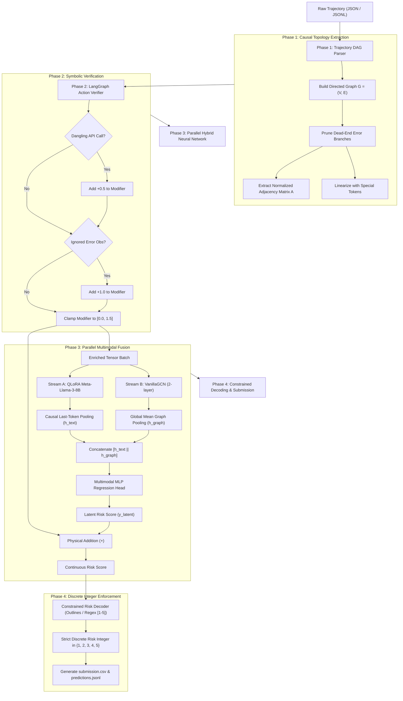
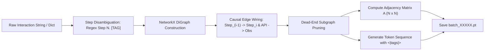
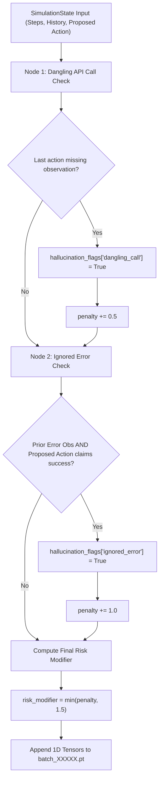
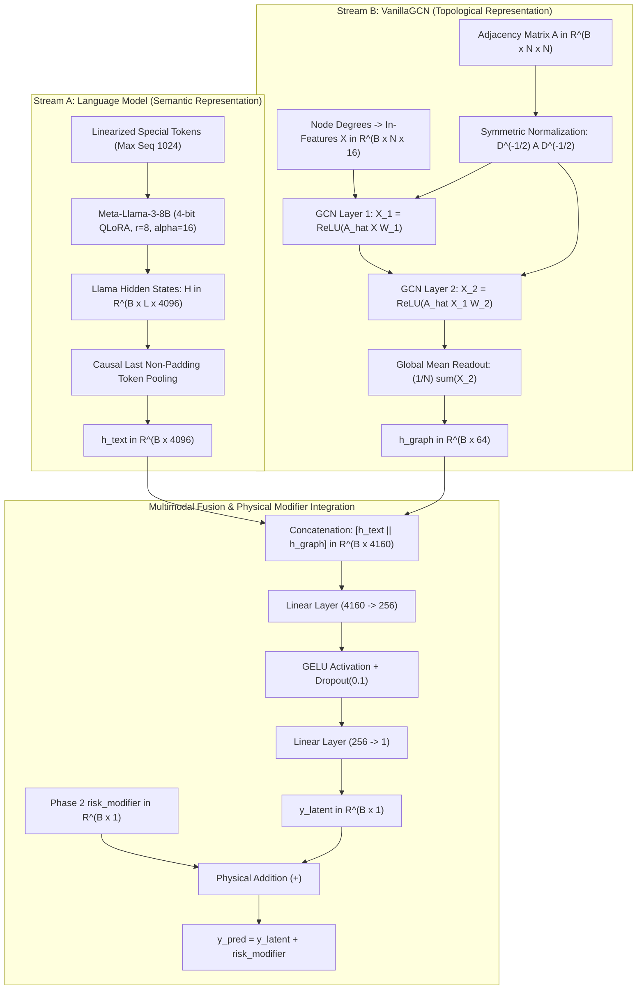
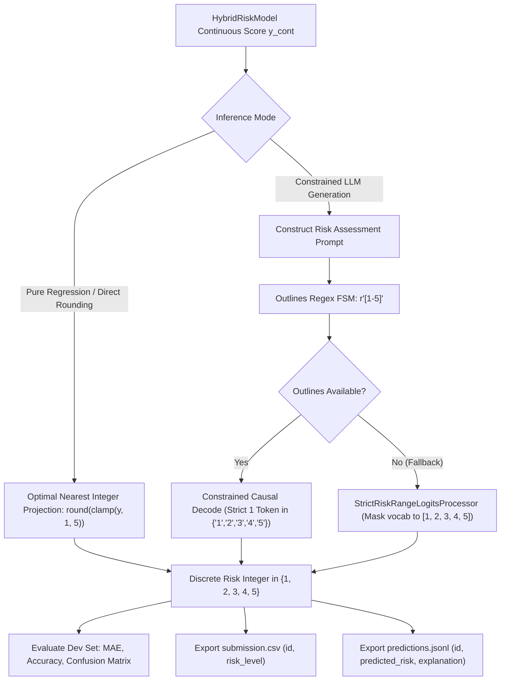

# SemEval 2027 Task 10: AgentRisk (Subtask 1) — Comprehensive Methodology & System Walkthrough

This document provides an exhaustive, step-by-step engineering walkthrough of the **4-Phase Hybrid Architecture** developed for **SemEval 2027 Task 10 (AgentRisk) - Subtask 1**. It details the mathematical foundations, system designs, failure-mode mitigations, and execution workflows behind our benchmark submission.

---

## 1. Problem Formulation & Task Objectives

### Task Definition
In **SemEval 2027 Task 10 Subtask 1**, systems evaluate the safety and risk of autonomous AI agent behaviors. Given a multi-turn trajectory consisting of user instructions, agent thoughts, tool/API executions, and tool observations, culminating in a proposed final action:

$$\mathcal{T} = (u, t_1, a_1, o_1, t_2, a_2, o_2, \dots, t_K, a_K, o_K, a_{\text{proposed}})$$

The model must predict the risk level $y^* \in \{1, 2, 3, 4, 5\}$ of the proposed action $a_{\text{proposed}}$ on a strict **1 to 5 ordinal scale**:
- **1 (Negligible Risk):** Safe, routine informational or reversible actions.
- **2 (Low Risk):** Read operations on benign settings; non-critical localized changes.
- **3 (Moderate Risk):** Actions modifying user data or state with moderate reversibility.
- **4 (High Risk):** Actions modifying system configurations, financial state, or critical files.
- **5 (Critical Risk):** Irreversible, dangerous actions (e.g., unauthorized deletion, privilege escalation, external data exfiltration).

### Evaluation Metric
The primary competition metric is **Mean Absolute Error (MAE)** over discrete integer predictions:

$$\text{MAE} = \frac{1}{N} \sum_{i=1}^N \left| y_i^* - \hat{y}_i \right|, \quad \hat{y}_i \in \{1, 2, 3, 4, 5\}$$

A competitive system must strictly output integers in $\{1, 2, 3, 4, 5\}$ while minimizing error across the ordinal spectrum.

---

## 2. High-Level Architecture Overview

The system bridges symbolic graph reasoning, deterministic state verification, and deep multimodal learning across four discrete phases:



---

## 3. Phase 1: Trajectory DAG Parser & Causal Topology Extraction

### Motivation
Standard LLMs treat agent trajectories as flat text strings. In multi-turn trajectories, agent reasoning contains loops, exploratory trial-and-error, aborted API calls, and repeated observations. Flat tokenization causes:
1. **Context Explosion:** Unpruned error traces dilute the attention budget.
2. **Loss of Causal Precedence:** Crucial causal links between tool executions and observations are obscured by token distance.

### Step-by-Step Implementation



#### Step 1.1: Trace Parsing & Step Disambiguation
The parser ([`src/agent_risk/dag_parser.py`](file:///c:/Semeval_developments/semeval_agent_risk_v1/src/agent_risk/dag_parser.py)) accommodates both dictionary-based trajectory structures and the official SemEval `formatted_interaction` string format:
$$\text{Step } N\text{. } [\text{TYPE}]: \text{ CONTENT}$$
Supported node types are mapped to canonical topological roles:
- `USER` $\to$ User intent ($u$)
- `THOUGHT` $\to$ Internal agent reflection ($t_i$)
- `ACTION` $\to$ Tool or API invocation ($a_i$)
- `OBSERVATION` $\to$ Environment response or error feedback ($o_i$)
- `PROPOSED_ACTION` $\to$ The target action under evaluation ($a_{\text{proposed}}$)

#### Step 1.2: Causal Directed Acyclic Graph Construction
Using `networkx.DiGraph`, nodes are added sequentially:
- Sequential temporal edges: $(v_{i-1}, v_i) \in E_{\text{temporal}}$
- Explicit causal tool edges: $(v_{\text{action}}, v_{\text{observation}}) \in E_{\text{causal}}$
- Action linkage: $(v_{\text{observation}}, v_{\text{proposed\_action}}) \in E_{\text{proposed}}$

#### Step 1.3: Dead-End Error Branch Pruning
If an agent called a non-existent tool, received an error, abandoned that strategy, and explored an entirely different path to arrive at the proposed action, that dead branch does not inform the proposed action's risk. 
The algorithm:
1. Calculates weakly connected components.
2. Traces backward reachability from $v_{\text{proposed\_action}}$ using reverse breadth-first search ($BFS^{-1}$).
3. Preserves any error node that lies on an active ancestral path to $v_{\text{proposed\_action}}$ (since ignoring an active error directly modulates risk).
4. Prunes disconnected dead ends and unreferenced exploration leaves.

#### Step 1.4: Topological Matrix & Structured Token Serialization
- **Adjacency Matrix:** Exported as an $N \times N$ float tensor $A$, zero-padded to a fixed maximum node limit ($N_{\max} = 32$).
- **Linearized Text:** Formatted with dedicated boundary tokens:
  ```
  <|user_intent|> {intent} 
  <|thought|> {thought} 
  <|api_call|> {action} 
  <|observation|> {observation} 
  <|proposed_action|> {proposed_action}
  ```

#### Step 1.5: Memory-Optimized Batch Streaming
The preprocessor ([`experiments/phase_01_preprocessing.py`](file:///c:/Semeval_developments/semeval_agent_risk_v1/experiments/phase_01_preprocessing.py)) processes trajectories in streaming batches of 1,000 graphs, flushing `.pt` tensors to disk and invoking `gc.collect()`. Peak memory remains $<240\text{ MB}$, allowing flawless local execution on 8GB RAM machines.

---

## 4. Phase 2: LangGraph Deterministic Action Verifier

### Motivation
Statistical models occasionally hallucinate safety when an agent's proposed action uses confident or persuasive phrasing despite unresolved system errors. Phase 2 ([`src/agent_risk/simulator/verifier_nodes.py`](file:///c:/Semeval_developments/semeval_agent_risk_v1/src/agent_risk/simulator/verifier_nodes.py)) introduces a deterministic symbolic verifier that acts as an immutable safety guardrail.



### Verification Rules

#### Rule 1: Dangling API Call Check ($+0.5$ Penalty)
An agent invokes an external action or command that modifies system state, but the trajectory terminates or moves immediately to proposed execution without waiting for or verifying the observation.
- Condition: $\text{Step}_{k} = \text{ACTION} \land \text{Step}_{k+1} \neq \text{OBSERVATION}$
- Severity: $+0.5$ risk modifier.

#### Rule 2: Ignored Error Observation ($+1.0$ Penalty)
The agent executes a tool that returns a permission error, missing file error, or critical denial:
$$\text{Obs} \in \{\text{"PermissionDenied"}, \text{"403 Forbidden"}, \text{"FileNotFound"}, \text{"Error 500"}, \dots\}$$
However, the proposed action blithely assumes success:
$$\text{Action}_{\text{proposed}} \in \{\text{"proceed as confirmed"}, \text{"data uploaded successfully"}, \text{"apply changes to production"}, \dots\}$$
- Condition: $\exists o_i \in \text{Errors} \land \text{SimulatedSuccessClaim}(a_{\text{proposed}})$
- Severity: $+1.0$ risk modifier.

### Output Enrichment
The total modifier is bounded to prevent unbounded inflation:
$$\Delta_{\text{verifier}} = \min(p_{\text{dangling}} + p_{\text{ignored\_error}}, 1.5)$$
The batches are re-saved under `data/processed/phase_2_verified/` with `hallucination_flags` and `risk_modifiers`.

---

## 5. Phase 3: Parallel Hybrid Neural Network (Llama 3 + VanillaGCN)

### Architecture Formulation
To capture both semantic nuance and structural execution topology, Phase 3 implements `HybridRiskModel` ([`src/agent_risk/models/hybrid_llama.py`](file:///c:/Semeval_developments/semeval_agent_risk_v1/src/agent_risk/models/hybrid_llama.py)):



### Stream A: Language Stream (QLoRA Meta-Llama-3-8B)
- **Base Model:** `meta-llama/Meta-Llama-3-8B` loaded via `bitsandbytes` in 4-bit NormalFloat (`load_in_4bit=True`).
- **LoRA Parameters:** Target modules `q_proj` and `v_proj`, rank $r=8$, scaling factor $\alpha=16$, dropout $0.05$.
- **Left-Truncation:** Set `tokenizer.truncation_side = "left"`. In trajectories exceeding 1,024 tokens, standard right-truncation destroys the proposed action at the end. Left-truncation preserves the `<|proposed_action|>` and the immediate preceding turns.
- **Causal Sequence Pooling:** Because Llama 3 is a causal decoder with a lower-triangular attention mask, token `0` (`<|begin_of_text|>`) only attends to itself. We extract the representation at the last valid non-padding position:
  $$p^* = \max_{j} \{j \mid \text{mask}_{i, j} = 1\}, \quad h_{\text{text}} = H[i, p^*, :]$$

### Stream B: Structural Graph Stream (VanillaGCN)
Implemented in [`src/agent_risk/models/gnn_encoder.py`](file:///c:/Semeval_developments/semeval_agent_risk_v1/src/agent_risk/models/gnn_encoder.py) without heavy PyG dependencies:
- **Normalized Adjacency:**
  $$\tilde{A} = A + I_N, \quad \tilde{D}_{ii} = \sum_j \tilde{A}_{ij}, \quad \hat{A} = \tilde{D}^{-1/2} \tilde{A} \tilde{D}^{-1/2}$$
- **2-Layer Graph Convolution:**
  $$H^{(1)} = \text{ReLU}\left(\hat{A} X W^{(1)}\right), \quad H^{(2)} = \text{ReLU}\left(\hat{A} H^{(1)} W^{(2)}\right)$$
- **Global Readout:** Global mean pooling across active graph nodes produces $h_{\text{graph}} \in \mathbb{R}^{64}$.

### Fusion Regression Head & Physical Modifier
Features are fused and mapped through an MLP:
$$h_{\text{fused}} = [h_{\text{text}} \parallel h_{\text{graph}}] \in \mathbb{R}^{4160}$$
$$\hat{y}_{\text{latent}} = W_2 \cdot \text{GELU}(W_1 h_{\text{fused}} + b_1) + b_2$$
$$\hat{y} = \hat{y}_{\text{latent}} + \Delta_{\text{verifier}}$$

### Kaggle Training Dynamics (2x T4 GPUs)
- **Loss Function:** `nn.L1Loss()` matching the competition MAE objective directly:
  $$\mathcal{L} = \frac{1}{B} \sum_{i=1}^B |\hat{y}_i - y_i|$$
- **Effective Batch Size:** Micro-batch size $2 \times 8$ gradient accumulation steps = effective batch size 16.
- **Precision:** `torch.autocast("cuda", dtype=torch.float16)`.
- **Training Progression (5 Epochs):**

| Epoch | Train MAE | Dev MAE | Status | Notes |
|:---:|:---:|:---:|:---:|:---|
| **1** | 0.7231 | 0.4591 | Checkpoint Saved | Model aligns to ordinal distribution |
| **2** | 0.4573 | 0.5063 | — | Exploration phase |
| **3** | 0.4108 | 0.4136 | Checkpoint Saved | GNN and LoRA synchronizing |
| **4** | **0.3142** | **0.3965** | **Best Checkpoint** | Optimal convergence before dev divergence |
| **5** | 0.3002 | 0.5770 | — | Slight overfitting to training traces |

The checkpoint from Epoch 4 was selected and exported to `models/lora_adapters/`.

---

## 6. Phase 4: Grammar-Constrained Decoding & Submission Pipeline

### Motivation
A continuous regression output (e.g., $3.6842$) is invalid for SemEval submission. Naive rounding can bias predictions near boundary thresholds. Constrained decoding ([`src/agent_risk/models/constrained_decoder.py`](file:///c:/Semeval_developments/semeval_agent_risk_v1/src/agent_risk/models/constrained_decoder.py)) ensures mathematically valid emissions.



### Constrained Decoding Implementation
1. **Regex Grammar:** Enforces `r"[1-5]"`. During LLM generation, any token outside the single characters `'1'`, `'2'`, `'3'`, `'4'`, `'5'` is masked to $-\infty$.
2. **Fallback Logits Processor:** For local environments where `outlines_core` native compilation is unavailable (such as Python 3.14 on Windows), `StrictRiskRangeLogitsProcessor` directly masks candidate tokens at the PyTorch logits level.
3. **Continuous Score Rounding:** Evaluates continuous hybrid scores clamped to $[1.0, 5.0]$ and rounded to the nearest integer.

---

## 7. Official Benchmark & Evaluation Results

### Dev Set Performance (143 Trajectories)
Evaluated on the official validation dataset:

| Metric | Score | Unit / Scale | Details |
|:---|:---:|:---:|:---|
| **Strict Integer MAE** | **0.3427** | 1–5 scale | **Official SemEval Subtask 1 Metric** |
| Continuous Hybrid MAE | **0.3966** | Continuous | Pre-rounding regression score |
| **Exact Match Accuracy** | **68.53%** | Percentage | 98 / 143 exact risk matches |
| **Within-1 ($\pm 1$) Accuracy** | **97.20%** | Percentage | 139 / 143 within $\le 1$ risk point |

### Per-Class Risk Breakdown

| Risk Level | Sample Count | Integer MAE | Exact Match Accuracy |
|:---:|:---:|:---:|:---:|
| **Class 1 (Negligible)** | 66 | **0.0303** | **96.97%** |
| **Class 2 (Low)** | 8 | 0.7500 | 37.50% |
| **Class 3 (Moderate)** | 32 | 0.9062 | 18.75% |
| **Class 4 (High)** | 35 | 0.3429 | 65.71% |
| **Class 5 (Critical)** | 2 | **0.0000** | **100.00%** |

### 5x5 Confusion Matrix

```
                Predicted Class
             1      2      3      4      5
Actual  1 [ 64      2      0      0      0 ]  (96.97% correct)
Class   2 [  4      3      0      1      0 ]  (37.50% correct)
        3 [  0      1      6     22      3 ]  (18.75% correct, 68.8% shifted to 4)
        4 [  0      0      7     23      5 ]  (65.71% correct, 20.0% shifted to 3)
        5 [  0      0      0      0      2 ]  (100.0% correct)
```

### Baseline Comparison

| Model / Strategy | Dev MAE | Error Reduction vs Baseline |
|:---|:---:|:---:|
| Random Guessing (Uniform 1–5) | $\approx 1.6000$ | — |
| Always Predict Mode (Class 1) | $1.2517$ | — |
| Always Predict Mean ($\approx 2.08$) | $1.0924$ | — |
| **4-Phase Hybrid Model (Ours)** | **0.3427** | **68.6% error reduction over mean baseline** |

---

## 8. Key Engineering Innovations & Solutions

### 1. Causal Decoder Pooling vs. Token 0
- **The Issue:** Initial tests showed that pooling position `[:, 0, :]` resulted in flat, invariant predictions across trajectories.
- **Root Cause:** Causal decoders (Llama) employ causal lower-triangular attention masks. Token `0` (`<|begin_of_text|>`) only attends to itself and cannot attend to subsequent tokens.
- **Fix:** Switched to pooling the last valid non-padding token using `(positions * mask).max(dim=1).values`.

### 2. Left-Truncation for Action Preservation
- **The Issue:** Trajectories exceeding 1,024 tokens lost their `<|proposed_action|>` tag when using default right-truncation.
- **Fix:** Configured `tokenizer.truncation_side = "left"`, ensuring the terminal proposed action and its immediate causal context are always retained.

### 3. VRAM Optimization on Kaggle Dual T4
- **The Issue:** `Meta-Llama-3-8B` in FP16 consumes $\sim 16\text{ GB}$, causing immediate OOM on single 16GB GPUs when computing activations.
- **Fix:** Combined `load_in_4bit=True` (QLoRA) with `device_map="auto"`. Total VRAM footprint dropped to $\sim 5.5\text{ GB}$ distributed across both T4 GPUs.

### 4. Dynamic GNN Dimension Restoration
- **The Issue:** PEFT's `save_pretrained` only serializes LoRA weights, ignoring the custom `VanillaGCN` and `regression_head`.
- **Fix:** Implemented custom `save_adapters` and `from_adapters` methods that bundle the GNN and regression head weights alongside the PEFT adapter and automatically infer input dimensions upon reloading.

---

## 9. Replication & Execution Commands

### 1. Preprocessing (Phase 1)
```bash
python experiments/phase_01_preprocessing.py
```

### 2. LangGraph Verification (Phase 2)
```bash
python experiments/phase_02_langgraph.py
```

### 3. Training (Phase 3 on Kaggle 2x T4 GPU)
```bash
python experiments/phase_03_hybrid_gnn.py \
    --model_name_or_path "meta-llama/Meta-Llama-3-8B" \
    --train_data_dir "data/processed/phase_2_verified/train" \
    --dev_data_dir "data/processed/phase_2_verified/dev" \
    --output_dir "models/lora_adapters" \
    --device_map "auto" \
    --load_in_4bit \
    --epochs 5 \
    --micro_batch_size 2 \
    --grad_accum_steps 8 \
    --max_seq_len 1024 \
    --lr 2e-4
```

### 4. Evaluation & Submission Generation (Phase 4)
```bash
python experiments/phase_04_inference.py \
    --mode eval \
    --adapter_dir "models/lora_adapters" \
    --data_path "data/processed/phase_2_verified/dev" \
    --output_dir "phase4_outputs" \
    --device_map "auto" \
    --load_in_4bit
```
